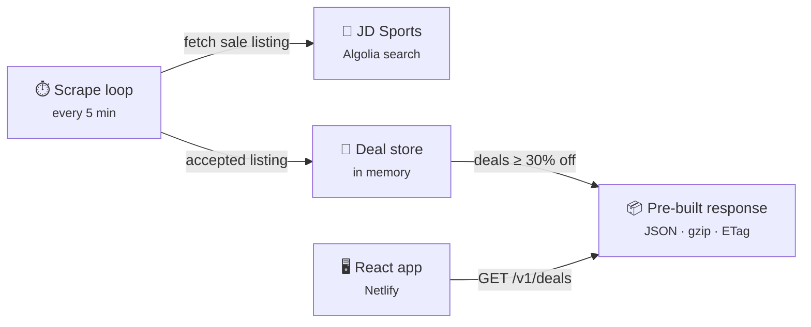

# Bargain Web Scraper

#### Try it out:
👕 https://bargain-scraper.netlify.app/

## Overview 🤔
- Finds heavily discounted clothing on JD Sports UK every few minutes and shows it in a clean, minimal React web app
- Tracks stock: sold-out items disappear from the site on the next scrape and come back if restocked
- ```Bun, TypeScript, React, Redux, Tailwind CSS```

## Architecture



## Features 🚀
### Frontend
- [React Web App](https://bargain-scraper.netlify.app/)
- Redux
- Tailwind CSS
- React Router (search params for filters)

### Backend
- Bun with zero runtime dependencies (built-in HTTP server, gzip and hashing)
- Reads JD's product search (Algolia) directly: one request per category instead of scraping HTML
- Sold-out detection, with a safety check so a failed fetch never wipes the list
- Responses built once per scrape and served from memory, with ETag/304 and gzip
- No database or files: everything lives in memory and is rebuilt by scraping on boot
- See [backend/README.md](backend/README.md) for details, and [FRONTEND_API.md](FRONTEND_API.md) for the API contract the frontend relies on
- [docs/backend-v2-rewrite.md](docs/backend-v2-rewrite.md): the story of the backend rewrite, its design decisions, the final result and open items

### Tech 💻
- Frontend hosted on Netlify
- Backend hosted on Render
- Git hooks (`.githooks/`, installed by `bun install` in `backend/`): typecheck + lint before each commit and the full checks before each push, for whichever app changed. An app opts in by defining `check:commit` / `check:push` scripts in its `package.json`
- GitHub Actions CI on every PR and push to main (`.github/workflows/ci.yml`); require the **CI passed** check before merging
- Automatic deployments from main
- Google Analytics

## Installation
```bash
cd frontend
npm install
npm start
```

```bash
cd backend
bun install
bun run dev
```

No API keys or database needed.
