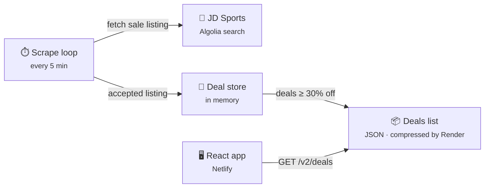
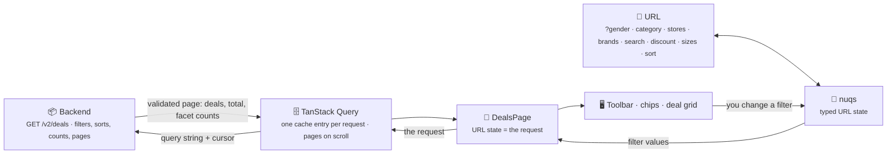

# Bargain Web Scraper

#### Try it out:
👕 https://bargain-scraper.netlify.app/

## Overview 🤔
- Finds heavily discounted clothing on JD Sports UK every few minutes and shows it in a fast, accessible React web app that works on phones and desktops
- Tracks stock: sold-out items disappear from the site on the next scrape and come back if restocked
- ```Bun, TypeScript, React 19, Vite+, Tailwind CSS 4, TanStack Query, nuqs```

## Architecture



## Features 🚀
### Frontend

The [web app](https://bargain-scraper.netlify.app/) lets you search, set a minimum discount, pick clothing and footwear sizes, and sort. Every filter lives in the URL, so any view can be bookmarked or shared, and links shared before the rewrite still open the same view. It works on phones (filters in a bottom sheet) and desktops (a sticky toolbar), in light and dark themes.

**How it fits together**



The filters live in the URL, and the URL is the request: the backend filters, sorts, counts and pages, and the app shows one page at a time as you scroll. `DealsPage` is the only place the two meet, and everything below it just displays what it's given.

**Tools and what they do here**

| Tool | Role |
| --- | --- |
| [Bun](https://bun.com) | Installs packages and runs scripts, the same as the backend. |
| [Vite+](https://viteplus.dev) (`vp`) | One toolchain configured in one file, `vite.config.ts`: Vite builds and serves the app, Vitest runs the tests, Oxlint lints (including the folder import rules below), Oxfmt formats, and TypeScript is type-checked, all through `vp check`, `vp test` and `vp build`. |
| React 19 + React Compiler | The UI. The compiler memoises components automatically, so the code needs almost no `useMemo` or `useCallback`. |
| TypeScript (strict) | Types everywhere, including the API response, the URL parameters and the filter values. |
| Tailwind CSS 4 | Styling. The colours, radii and font are design tokens defined in CSS (`src/styles/theme.css`), not Tailwind's default palette. |
| [TanStack Query](https://tanstack.com/query) | Fetches and caches the deals: retries network errors, refreshes every 5 minutes and when you come back to the tab, and saves the last list in the browser for 24 hours. |
| [nuqs](https://nuqs.dev) | Keeps the filters in the URL with typed parsers: defaults are left out, history isn't spammed, and search writes are throttled. |
| zod (mini) | Checks every deal the API returns. Bad items are dropped instead of breaking the page. |
| [Base UI](https://base-ui.com) | Unstyled, accessible building blocks for the sizes popover, the About dialog and the size toggles. |
| lucide-react | The icons. |
| class-variance-authority + clsx | Style variants for the shared components (button tones, chip sizes). |
| Vitest, Testing Library, MSW, axe | Unit and component tests in a simulated browser, with the API mocked at the network level and an accessibility check on every state. |
| Playwright | End-to-end tests in a real browser at phone and desktop sizes, against the built app with the API stubbed. |
| size-limit | Fails the build if the JavaScript, CSS or font grows past its budget. |

**Key concepts**

- **The URL is the filter state.** There's no separate store to keep in sync. Changing a filter rewrites the URL (replacing the history entry, so Back still leaves the page); reloading or opening a shared link restores the exact view.
- **A new filter is one registry entry.** Each filter in `features/filters/model/registry.ts` declares how it's read from and written to the URL, when it's active, how it filters a deal, and its removable chip. The URL handling, the filter pass, the chips, "Clear all" and the phone's "Filters (n)" count all come from that list; only the control is written by hand.
- **Waking a sleeping server.** Render's free tier sleeps, and a freshly started backend answers `503` until its first scrape finishes. The app shows the last list saved in the browser straight away, retries quietly as the server asks (for up to two minutes), says "Waking the server" after 3 seconds, and only then shows an error. If a refresh fails while a list is on screen, a small banner says the deals may be out of date.
- **Explaining an empty result.** When the filters match nothing, the backend's counts say which single filter to relax, and the app offers those as one-tap fixes, for example "Show 12 deals at 50% or more".
- **Layers with enforced boundaries.** `app/` (page and layout) uses `features/` (deals, filters, theme, about), which use `shared/` (generic UI and helpers). Imports only go downwards, features are used only through their `index.ts`, and the deals feature never imports filters. Breaking these rules is a lint error, not a code-review comment.
- **Design tokens and themes.** Components use semantic colours (`accent`, `surface`, `text-muted`) defined once in CSS; the dark theme just swaps their values. A tiny script in `index.html` picks the theme before the first paint, so there's no flash, and it follows the system setting until you choose one.
- **Accessible by default.** Header, main and footer landmarks, a skip link, native controls where they exist (radio buttons, a `<select>`, a `<dialog>` sheet), and every control named for screen readers. axe runs against each state in tests.
- **Fast on a phone.** Product images come from JD's image CDN at the width each card needs (`srcset`); the first ten load straight away and the rest lazily. Cards off screen skip layout until scrolled to. The filter sheet and About dialog load only when opened, and the font is a 40 KB self-hosted subset with a size-matched fallback so text doesn't jump when it loads.

**Tests**

Tests check behaviour (roles, accessible names, URL writes, requests made), never class names, so a restyle can't break them. Unit tests cover the data model, the filter pass and the URL parsing; component tests render the real page against MSW for success, empty, error, retry and slow-server states; Playwright covers search, the phone sheet, a reload restoring filters, the theme, layout at 390 px and 1280 px, and axe in both themes. CI never calls the real API.

**Layout**

```
frontend/
  src/
    app/        page, layout (header, footer), providers
    features/
      deals/    API client, schema, deal model, grid and cards
      filters/  registry, filter pass, URL state, toolbar, sheet
      theme/    light / dark toggle
      about/    About dialog
    shared/     generic UI (Button, Chip, Dialog…), formatting, config
    styles/     tokens, base styles, font
    mocks/      MSW handlers used by tests and dev:mock
  e2e/          Playwright tests
  netlify.toml  build command, SPA redirect, caching and security headers
```

See [docs/frontend-rewrite-spec.md](docs/frontend-rewrite-spec.md) for the full design and [docs/frontend-rewrite-notes.md](docs/frontend-rewrite-notes.md) for every decision made while building it.

### Backend
- Bun with zero runtime dependencies (built-in HTTP server)
- Reads JD's product search (Algolia) directly: one request per category instead of scraping HTML
- Sold-out detection, with a safety check so a failed fetch never wipes the list
- The deals list is rebuilt after each scrape and served from memory with browser caching; Render compresses responses (Brotli)
- No database or files: everything lives in memory and is rebuilt by scraping on boot
- See [backend/README.md](backend/README.md) for details, and [FRONTEND_API.md](FRONTEND_API.md) for the API contract the frontend relies on
- [docs/backend-v2-rewrite.md](docs/backend-v2-rewrite.md): the story of the backend rewrite, its design decisions, the final result and open items

### Tech 💻
- Frontend hosted on Netlify (settings in `frontend/netlify.toml`, so they're reviewed in pull requests)
- Backend hosted on Render
- Git hooks (`.githooks/`, installed by `bun install` in `backend/` or `frontend/`): typecheck + lint before each commit and the full checks before each push, for whichever app changed. An app opts in by defining `check:commit` / `check:push` scripts in its `package.json`
- GitHub Actions CI on every PR and push to main (`.github/workflows/ci.yml`); require the **CI passed** check before merging
- Automatic deployments from main

## Installation
```bash
cd frontend
bun install
bun run dev        # against the backend on localhost:8000
bun run dev:mock   # no backend needed: serves a saved list (add ?mock=loading, ?mock=bad-gateway or ?mock=offline)
bun run test       # unit and component tests
bun run test:e2e   # Playwright end to end (builds the app first)
bun run check      # what CI runs: format, lint, types, tests with coverage, build, size budgets
```

```bash
cd backend
bun install
bun run dev
```

No API keys or database needed.
