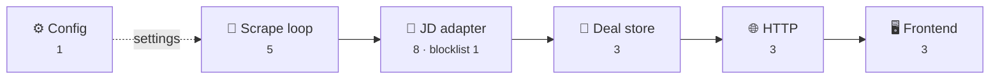

# Code review fixes still in effect

The backend went through five code-review rounds and a simplification rewrite. Much of the code those reviews fixed has since been deleted, so this file keeps **only the fixes that still apply to today's code**, grouped by area. Each one names the test that guards it, so a regression fails the build.

For the overall story, see [`docs/backend-v2-rewrite.md`](../docs/backend-v2-rewrite.md).

Where the fixes sit along the data flow (numbers = fixes in each part; CI has one more):

---

## 🛒 JD adapter (`src/retailers/jd.ts`)

| Problem it prevents | How it's handled today | Guarded by (`test/jd.test.ts`) |
|---|---|---|
| Sales over 1,000 items failed every scrape | Reads every Algolia page (up to 10) | *reads every page of a large listing* |
| Algolia silently holding products back (pagination cap) | The listing is marked **incomplete**, so nothing is removed | *keeps a truncated listing but marks it incomplete…*, *treats an empty page past the pagination cap as truncation…* |
| Algolia's estimated counts making listings look incomplete forever | A short, non-empty last page counts as the real end; an exact count with missing items stays incomplete | *trusts a short last page when Algolia says its count is an estimate*, *treats an exact count with missing products as incomplete* |
| One failed category throwing away the others | Keeps the categories that worked and marks the run incomplete; fails only if *every* category fails | *keeps the listings that worked when one fails…*, *fails the run when every listing fails* |
| Stale search filters (JD renames a facet) emptying the site | Re-reads the listing page whenever cached settings find nothing; a genuinely empty sale costs one extra page read per run | *re-reads the listing page when a cached config suddenly finds nothing*, *accepts a genuinely empty sale* |
| Rotated keys or a changed index failing forever | On any error, the cached settings are forgotten and relearned next run | *throws when Algolia errors, and relearns the config next time* |
| Algolia's stale stock showing sold-out products | Each in-stock product's page is read for live stock and sizes (6 at a time, each page once). ETags make unchanged pages a bodiless 304; pages that leave a complete listing are forgotten | *takes stock from the product page, and reuses it when the page answers 304*, *marks a product out of stock when its page says so…*, *reads a product page once when the product is in several listings*, *stops sending an old ETag…*, *forgets product pages that leave a complete listing* |
| An unreadable product page bringing a sold-out product back | Falls back to the page's last known stock, then Algolia's, and warns once per run with the failure count | *falls back to the last known page stock when a product page fails, and warns*, *keeps Algolia's stock when a product page can't be read…* |

## 🧠 Deal store (`src/deals.ts`)

| Problem it prevents | How it's handled today | Guarded by (`test/deals.test.ts`, `test/app.test.ts`) |
|---|---|---|
| A sale that ends completely (zero items) never being cleared | A drop is held once, then accepted when the next scrape confirms it, **including zero** | *clears a sale that ends completely after one confirming run*, *clears everything when a sale ends…* |
| The sudden-drop guard getting stuck, or confirmed by the wrong runs | A normal run forgets a held drop; an incomplete listing never counts as confirmation | *forgets a held drop when the next run is back to normal*, *does not count an incomplete listing as confirming a drop* |
| A product listed twice (men's and women's) ending up with the wrong stock or gender | In stock if any copy is; different genders become `Unisex` | *counts a product as in stock if any copy is, and marks mixed genders as unisex* |

## 🔁 Scrape loop (`src/scraper.ts`, `src/app.ts`)

| Problem it prevents | How it's handled today | Guarded by |
|---|---|---|
| A failed scrape leaving the site empty or stale for 5 minutes | Retries after 15s, doubling each time, capped at the interval | *waits the interval after a success, and retries sooner, doubling…*, *keeps answering 503 while JD is down, retries quickly, and recovers* |
| One failing retailer making healthy ones re-scrape every 15s | One loop per retailer, each with its own backoff | *retries a failing retailer quickly without re-scraping the healthy one* |
| An adapter throwing *synchronously* sinking the whole scrape | Recorded as that retailer's failure; its previous products are kept | *records a failure, even a synchronous throw…* |
| Wrong per-retailer timings | Each fetch is timed on its own, measured *after* it finishes (a bug caught during the rewrite) | *times the fetch* |
| A loop bug quietly serving stale deals forever | The loop isn't caught: the process exits and Render restarts it | Checked by hand: Bun exits with code 1 |

## 🌐 HTTP (`src/http.ts`)

| Problem it prevents | How it's handled today | Guarded by (`test/http.test.ts`, `test/app.test.ts`) |
|---|---|---|
| Health checks or pings aimed at `/` getting a 404 | `/` answers like `/health` | *answers health checks on / and /health…* |
| Visitors seeing an empty site or error page right after a deploy | Instant `503` + `Retry-After: 10` until the first good scrape | *answers 503 with a readable Retry-After until the first scrape* |
| **The browser hiding `Retry-After`** from frontend code, and **blocking `/health`** (cross-origin) | `Access-Control-Expose-Headers: Retry-After`; CORS on `/health` too. Confirmed in Chromium before and after | *answers 503 with a readable Retry-After…*, *answers health checks on / and /health…* |

## ⚙️ Config (`src/config.ts`) and blocklist (`src/retailers/blocklist.ts`)

| Problem it prevents | How it's handled today | Guarded by |
|---|---|---|
| `MIN_DISCOUNT=0` silently becoming 30; typos, decimals or hex accepted; a huge interval overflowing the timer into non-stop scraping | Whole numbers only, range-checked, fail at startup; interval capped at one day | *reads overrides, keeping 0 as 0*, *fails fast on typos, decimals, hex and out-of-range values* |
| "cap" blocking "Capri", and plurals like "Caps" slipping through | Whole words, optionally plural | *matches whole words only*, *blocks plurals too* |

## 🖥️ Frontend and CI

| Problem it prevents | How it's handled today | Guarded by |
|---|---|---|
| The error page instead of deals right after a deploy | `getItemsService` retries `503`s using `Retry-After` (at least 1s, 10s if missing, up to 3 times) | `webScrape.service.spec.ts` |
| A missing `Retry-After` causing instant retries (it parsed as `0`) | Falls back to 10s, minimum 1s | *falls back to a default wait…*, *never retries faster than once a second…* |
| "Found 14:32" when the item was found days ago | Shows the date when it isn't today | `formatFoundTime.spec.ts` |
| Path-filtered CI checks blocking PRs that touch only one app; pushes to `main` cancelling each other | One workflow with change detection and one required **CI passed** check; only PR runs are cancelled | Workflow scripts tested locally against real history |

---

## No longer applicable

These fixes were real at the time, but the code they fixed was **removed** in the simplification rewrite, so the problems can no longer happen:

| Old fix | Why it's gone |
|---|---|
| Validating `deals.json`, file format versions, atomic saves | No file any more: memory only |
| A stored "last in-stock count" baseline | Replaced by `DealStore`'s simpler hold-once rule |
| Purging sold-out items after 7 days; retiring removed retailers | Sold-out items are removed immediately; memory starts empty on each boot |
| Boot wait, shared deadline, raised server idle timeout | Replaced by an instant `503` |
| Retry timer and failure counter; overlapping-run flag | Replaced by one simple loop per retailer |
| Bounded shutdown on SIGTERM | Nothing to save any more, so the default exit is fine |
| `POST /jobs/scrape` and its secret | Removed with the Supabase cron design |
| Our own gzip (with `q=0` handling), ETags and 304s (weak and list matching) | Render already compresses every response (Brotli), and `Cache-Control` covers browser caching |

Known limitations that were **parked on purpose** (edge cases, not normal running) are listed under "Open items" in [`docs/backend-v2-rewrite.md`](../docs/backend-v2-rewrite.md).
