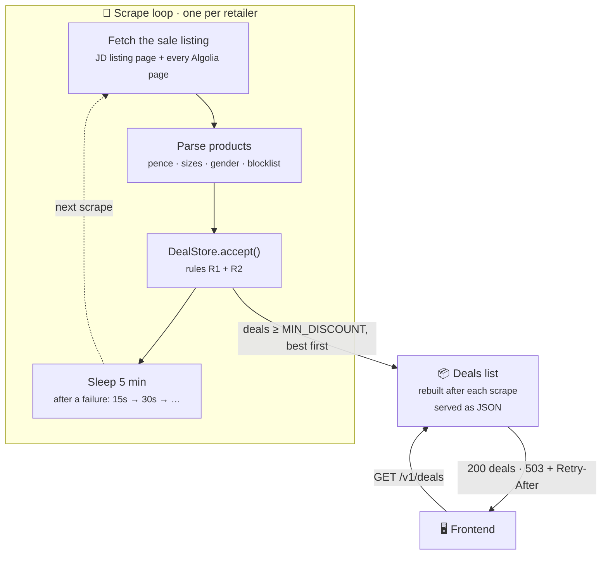
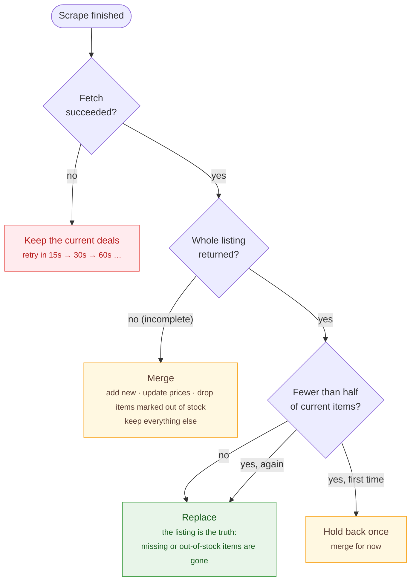

# Backend

The deals API and scraper. It runs on Bun with **zero runtime dependencies**: the HTTP server is built into Bun, everything is held in memory, and Render compresses responses on the way out.



## Rules

These are the behaviours the code is built around, and the end-to-end tests (`test/app.test.ts`) check each one.

| | Rule |
|---|---|
| **R1** | The deals served are the latest accepted listing. A product that sells out is simply gone. |
| **R2** | A bad fetch never wipes deals. A failed fetch keeps the previous list. An incomplete listing adds, refreshes and drops what it says is out of stock, but removes nothing else. A sudden drop of over 50% is held back once, then accepted if the next scrape confirms it (even at zero). This may be removed later: see [#59](https://github.com/JahanU/bargain-web-scraper/issues/59). |
| **R3** | Before the first good scrape, deal requests get an immediate `503` with `Retry-After: 10`, and the frontend retries. |
| **R4** | One loop per retailer, so its scrapes never overlap and one failing retailer never makes the others scrape more often: scrape, then sleep 5 minutes, or 15s, 30s, 60s… (capped at 5 minutes) after a failure. |
| **R5** | Memory only. Render's free tier wipes the disk anyway, so the app scrapes on boot. "Found" is when this process first saw the item. |

How `DealStore.accept()` applies R1 and R2 to each scrape:



## Files

| File | What it does |
|---|---|
| `src/index.ts` | Entry point: reads config and starts the app |
| `src/app.ts` | Wires the store, a scrape loop per retailer and the server together |
| `src/deals.ts` | `DealStore`: applies R1 and R2, and builds the deals list (≥ `MIN_DISCOUNT`, best first) |
| `src/http.ts` | The deals response (JSON with caching headers, or 503 until ready), the routes, and request logging |
| `src/scraper.ts` | `scrapeRetailer` (one timed, failure-safe scrape) and the loop (R4) |
| `src/retailers/jd.ts` | JD adapter: learns JD's Algolia settings from a listing page, reads every page, flags incomplete results, and checks live stock on each product page |
| `src/retailers/blocklist.ts` | Names to skip (team kits, caps…), matched as whole words and plurals |
| `src/retailers/types.ts` | `Product`, `Listing` and `Retailer`. A new retailer is one new file |
| `src/config.ts`, `src/log.ts` | Environment settings (validated at startup) and readable, levelled logging |

## Configuration

All settings are optional environment variables (see `.env.example`), validated at startup; an invalid value stops the app with a clear error.

| Variable | Default | Range | What it does |
|---|---|---|---|
| `PORT` | `8000` | 1–65535 | Port to listen on (Render sets this) |
| `MIN_DISCOUNT` | `30` | 0–100 | Lowest discount (%) served. Applied only when the deals list is built: the store keeps every in-stock sale item, so an item whose discount rises past the floor appears on the next scrape |
| `SCRAPE_INTERVAL_MINUTES` | `5` | 1–1440 | Time between scrapes per retailer. After a failure it retries sooner (15s, doubling, up to this) |
| `LOG_LEVEL` | `info` | `debug` `info` `warn` `error` `silent` | How much to log (see Logs) |

Settings are read once at startup, so a change needs a restart or redeploy.

## Endpoints

The full contract for the frontend (the `Deal` type, the loading state, caching, CORS) is in [`FRONTEND_API.md`](../FRONTEND_API.md).

| Method | Path | Notes |
|---|---|---|
| GET | `/health` (also `/`) | `{ ok, ready, deals, runs }`, where `runs` is the last result per retailer. Use it for the keep-awake ping |
| GET | `/v1/deals` | Deals, best first, as JSON (cached by browsers for 60s) |
| GET | `/webscrape/getBestDeals` | Same payload; the path the current frontend calls (new code should use `/v1/deals`) |

## Logs

One aligned, readable line per step, coloured in a terminal and plain text on Render:

```
09:41:02.121 INFO  app      ✓ listening on http://localhost:8000/  retailers=jd
09:41:02.122 INFO  scraper  ▶ scraping jd
09:41:03.010 INFO  scraper  ✓ jd scraped  status=ok products=312 added=4 removed=2 took=888ms
09:41:03.012 INFO  app      ✓ serving 280 deals
09:41:03.012 INFO  scraper  ⏱ jd: next scrape in 5m
09:41:07.441 INFO  http     GET /v1/deals → 200  took=0.4ms
09:46:03.990 ERROR scraper  ✗ jd scrape failed  error="Algolia search failed with status 503" took=410ms
09:46:03.991 WARN  scraper  ↻ jd: retrying in 15s  failures=1
```

| Symbol | Meaning |
|---|---|
| ▶ / ✓ / ✗ | step started / succeeded / failed (with an indented stack trace) |
| ⚠ | something the safety rules handled, e.g. a drop held back or an incomplete listing |
| ⏱ / ↻ | next scheduled scrape / retry after a failure |

Set `LOG_LEVEL=debug` to also see JD's internal steps (listing page, each Algolia page, how many hits were skipped) and the `/health` pings, which are hidden by default. Use `warn` or `error` for quieter logs, or `silent` (as the tests do). Colours: `FORCE_COLOR=1` or `NO_COLOR=1`.

If the scrape loop ever crashes (only possible through a bug), the process exits and Render restarts it, rather than serving stale deals.

## Development

```bash
cp .env.example .env   # all settings are optional
bun install            # dev tooling only
bun run dev
```

```bash
bun run check          # typecheck + lint + tests with a coverage floor (what CI runs)
bun test               # tests only
bun run lint:fix       # format and auto-fix lint issues
```

### Git hooks

`bun install` also installs the repo's git hooks (`.githooks/`, via `git config core.hooksPath`):

| Hook | Runs | Blocks |
|---|---|---|
| `pre-commit` | `bun run check:commit`: typecheck + lint/format (~1s) | the commit, if they fail |
| `pre-push` | `bun run check:push`: everything CI runs, including tests and coverage | the push, if they fail |

They only run for apps with changes (a docs-only commit runs nothing). Formatting fails? Run `bun run lint:fix`. In an emergency, `--no-verify` skips them; CI still checks everything.

Import from `src` with the `@/` alias (e.g. `import { createLogger } from '@/log'`). Bun resolves it from `tsconfig.json`, with no build step.

| Tool | Role | Config |
|---|---|---|
| `tsc` | Strict type checking only (Bun runs the TypeScript directly) | `tsconfig.json` |
| Biome | Formatter and linter | `biome.json` |
| `bun test` | Tests, silenced logs, and a coverage floor (95% of lines, 85% of functions) | `bunfig.toml` |

## Deploying on Render

- **Root directory:** `backend`
- **Build command:** `bun install`
- **Start command:** `bun run start`
- Optionally set `MIN_DISCOUNT`, `SCRAPE_INTERVAL_MINUTES` and `LOG_LEVEL` (see Configuration).
- Point the keep-awake ping at `/health`.
