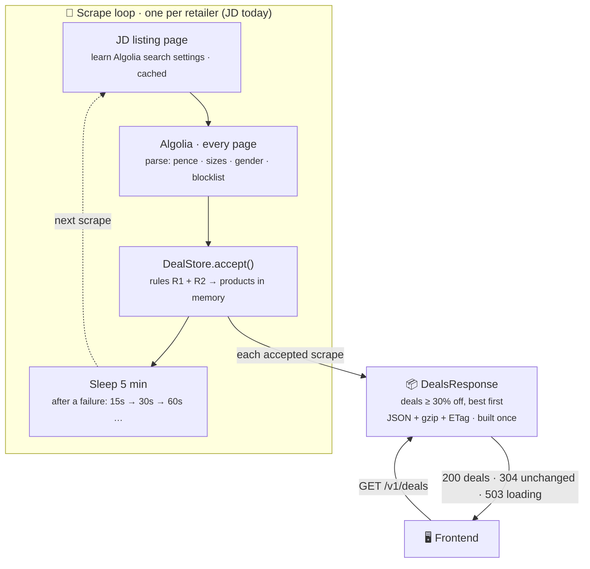
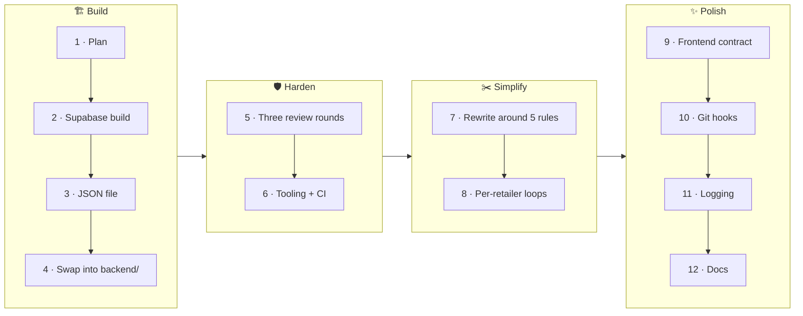

# Backend v2: the rewrite, start to finish

A single place to review **what was done, why, and where things ended up**. For day-to-day details, see [`backend/README.md`](../backend/README.md) (how it works and how to run it) and [`FRONTEND_API.md`](../FRONTEND_API.md) (the contract the frontend relies on).

**Branch:** `feature/backend-v2-refactor` (22 commits, not yet merged into `main`)

---

## 1. At a glance

| | Before (`main`) | After |
|---|---|---|
| Runtime | Node-style code on Bun, Hono framework | Bun only, using its built-in server, gzip and hashing |
| Runtime dependencies | **7** (Firebase ×3, Hono, Cheerio, dotenv, Telegram) | **0** |
| Source | 18 files, 898 lines (116 of them a commented-out Nike scraper) | 10 files, 942 lines |
| Sold-out items | Shown for up to 24 hours | Gone within about 5 minutes |
| After a restart | Empty site until the next scrape, plus a daily reset bug | Scrapes on boot; visitors get "loading" (503) and the frontend retries |
| A bad fetch | Could wipe or empty the list | Can't: the safety rules hold the last good deals |
| Serving | Array rebuilt and JSON encoded on **every** request | Built **once per scrape**; gzip, ETag/304, browser caching |
| Tests | 39, tied to Firebase/Telegram | **68 backend** (100% function coverage) **+ 81 frontend**, including end-to-end scenarios against the real server |
| Quality gates | None | Strict TypeScript, Biome lint/format, coverage floor, CI on every PR, git hooks on commit/push |
| Logs | `console.log` here and there | Readable, aligned, levelled logs across the whole flow |

About the same amount of code, doing much more, with nothing to install at runtime.

---

## 2. How it works now



### The five rules everything is built around

| | Rule |
|---|---|
| **R1** | The deals served are the latest accepted listing. A sold-out product is simply gone. |
| **R2** | A bad fetch never wipes deals. A **failed** fetch keeps the old list. An **incomplete** fetch only adds, updates, or drops items it says are out of stock. A **drop below 50%** is held back once, then applied if the next scrape confirms it ([#59](https://github.com/JahanU/bargain-web-scraper/issues/59): may be removed later). |
| **R3** | Until the first good scrape, deal requests get an instant `503` + `Retry-After: 10`, and the frontend retries. |
| **R4** | One loop per retailer: runs never overlap, and one failing retailer never makes the others scrape more often. |
| **R5** | Memory only. Render's free tier wipes the disk anyway, so the app scrapes on boot. |

### What happens to one item

| Event | Result |
|---|---|
| New item on sale | Appears after the next scrape (≤ 5 min) |
| Price drops further | Updated next scrape; keeps its original "found" time |
| Sells out (marked out of stock, or gone from JD) | Removed next scrape |
| Restocked | Comes back, with a fresh "found" time |
| Discount crosses 30% | Appears next scrape: the store keeps *every* sale item, and the 30% floor is applied only when the list is built |

### Files

| File | Job |
|---|---|
| `src/index.ts` | Entry point: reads settings, starts the app |
| `src/app.ts` | Wires the server, the store and a loop per retailer |
| `src/deals.ts` | `DealStore`: rules R1 and R2, builds the deals list |
| `src/http.ts` | Pre-built response (gzip, ETag, 304, 503), routes, request logging |
| `src/scraper.ts` | One scrape, plus the loop with retry backoff |
| `src/retailers/jd.ts` | The JD adapter (Algolia, paging, stale settings, partial results) |
| `src/retailers/blocklist.ts` | Names to skip: team kits, caps… |
| `src/retailers/types.ts` | `Product` / `Listing` / `Retailer`: a new store is one new file |
| `src/config.ts`, `src/log.ts` | Validated settings; readable logs |

---

## 3. The journey

The final design came out of several iterations. Each step taught something that shaped the next.



| # | Step | What happened | What it taught |
|---|---|---|---|
| 1 | **Plan** | Planned a Bun + Supabase Postgres rewrite, with Supabase cron driving scrapes | — |
| 2 | **First build** | Built it in `backend-v2/`, with Postgres tables, a transactional "reconcile" step and an advisory lock | Worked, but needed a database and cron setup for a few hundred items |
| 3 | **Storage rethink** | Swapped Postgres for an in-memory list saved to a JSON file | Simpler, no setup… but Render's free disk is wiped anyway |
| 4 | **Swap in** | Moved the rewrite into `backend/`, kept the old URL so the frontend kept working, deleted the old backend | — |
| 5 | **Three review rounds** | Fixed 28 findings: a stuck 50% guard, listings over 1,000 items, boot timeouts, ETags, CORS edge cases… | Patching piece by piece kept creating new issues in the same area |
| 6 | **Tooling** | `@/` imports, Biome, coverage floor, one CI workflow with a single "CI passed" check | — |
| 7 | **Simplification rewrite** | Wrote down five rules first, then rebuilt the backend around them: no file, one loop, an instant 503, end-to-end tests | **Design the whole flow first, then code.** This removed the class of bugs the reviews kept finding. |
| 8 | **Per-retailer loops** | One failing store no longer makes healthy ones re-scrape every 15s | — |
| 9 | **Frontend contract** | Wrote `FRONTEND_API.md`; that surfaced two real CORS bugs, confirmed in Chromium and fixed | Check things the way the real client sees them |
| 10 | **Git hooks** | Typecheck + lint on commit, full checks on push, per app | — |
| 11 | **Logging** | Readable, levelled logs across the whole flow | — |
| 12 | **Docs and housekeeping** | READMEs, configuration table, CI actions on v7, branch renamed, history cleaned of Claude tags, issue #59 | — |

---

## 4. Key decisions

| Decision | Why | Trade-off |
|---|---|---|
| **No database, memory only** | The data is a few hundred items and fully re-creatable from JD; Render's free disk is wiped on restart | "Found" times reset on each deploy |
| **Zero runtime dependencies** | Bun has the server, gzip and hashing built in: nothing to update or audit at runtime | Small HTTP details (gzip negotiation, ETags) are our own code, but tested |
| **Read JD's Algolia search directly** | One request per page of 1,000 items instead of scraping HTML | Depends on JD's page structure; it detects stale settings and re-reads them |
| **Filter at 30% only when building the list** | Items that cross 30% appear automatically; sold-out detection stays accurate | The store holds more than it serves |
| **Hold back drops below 50% once** | A "successful" but bad fetch can't empty the site | Genuine large drops show 5 minutes later (see #59) |
| **Crash on a loop bug rather than catch it** | Render restarts the service instead of serving stale deals forever | — |
| **Native git hooks, not Husky** | No root `package.json`; each app opts in through its own scripts | — |
| **Classes only for long-lived state** | `DealStore` and `DealsResponse` hold state; everything else is plain functions | — |

---

## 5. Quality and operations

**Checks**

| Where | What runs |
|---|---|
| On commit (hook) | Typecheck + lint/format for changed apps (~1s) |
| On push (hook) | Everything CI runs, including tests and the coverage floor |
| On every PR / push to `main` (CI) | Change detection, then Backend and/or Frontend, then the single required **CI passed** check |

**Settings** (all optional, validated at startup): `PORT`, `MIN_DISCOUNT` (30), `SCRAPE_INTERVAL_MINUTES` (5), `LOG_LEVEL` (info).

**Logs:** one readable line per step, for example

```
09:41:03.010 INFO  scraper  ✓ jd scraped  status=ok products=312 added=4 removed=2 took=888ms
09:41:03.012 INFO  http     ✓ serving 280 deals  json=96.1KB gzip=18.2KB
```

`LOG_LEVEL=debug` adds JD's internal steps and health pings.

**Deploy (Render):** root `backend`, build `bun install`, start `bun run start`; keep-awake ping on `/health`.

---

## 6. For the frontend rewrite

Everything is in [`FRONTEND_API.md`](../FRONTEND_API.md). The essentials:

- Call **`GET /v1/deals`**, which returns a sorted array of `Deal`.
- On **`503`**, wait `Retry-After` and retry for **about 2 minutes** (the current frontend gives up after about 30s).
- Use a **plain `fetch`**: the browser handles gzip and ETags.
- `gender` can be **`Unisex`**; `sizes` and `imageUrl` may be missing; prices are numbers in GBP; `inStock` is gone.

---

## 7. Open items

| Item | Status |
|---|---|
| **Merge** `feature/backend-v2-refactor` into `main` | To do (open a PR so CI runs) |
| **Delete** the old branch `claude/nice-dijkstra-g74pzj` on GitHub | To do (I wasn't allowed to delete it) |
| **Branch ruleset** on `main`, requiring "CI passed" | To set up after the first CI run |
| **50% guard**: keep or remove after testing JD | [#59](https://github.com/JahanU/bargain-web-scraper/issues/59) |
| **`bun.lock` downloads from `registry.npmmirror.com`** | Decide whether that's intended; regenerating against the official registry is one command |
| Empty root `package-lock.json` | Leftover; safe to delete |
| **Frontend rewrite** | Planned; the contract is ready |

**Known limitations, parked on purpose** (edge cases, not affecting normal running):

- A listing that's incomplete on *every* scrape never removes delisted items.
- Stale JD filters that still return *some* results aren't detected.
- "Found" times reset on every deploy.
- `/health` reports `ok: true` even when no scrape has succeeded; use its `ready` field.
- Listings that are neither men's nor women's would be labelled "Female". Worth fixing when gender support is added.

---

## 8. Where everything lives

| File | Purpose |
|---|---|
| `docs/backend-v2-rewrite.md` | This document |
| `README.md` | Project overview |
| `FRONTEND_API.md` | Frontend ↔ backend contract |
| `backend/README.md` | Backend guide: rules, files, configuration, logs, development, deploy |
| `backend/CODE_REVIEW_FIXES.md` | The review fixes still in effect, by area, each with the test that guards it |
| `backend/.env.example`, `tsconfig.json`, `biome.json`, `bunfig.toml`, `package.json` | Settings, types, lint, tests, scripts |
| `.github/workflows/ci.yml` | CI |
| `.githooks/` | Git hooks |
| [Issue #59](https://github.com/JahanU/bargain-web-scraper/issues/59) | The 50% guard decision |
